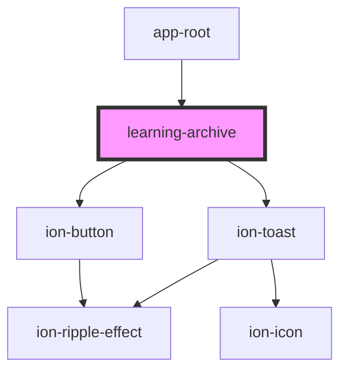

# learning-archive

<!-- Auto Generated Below -->

## Properties

| Property      | Attribute | Description                          | Type              | Default |
| ------------- | --------- | ------------------------------------ | ----------------- | ------- |
| `checkpoints` | --        | 编排台检查点目录（只读），由 app-root 注入，档案不反向改课程。 | `CheckpointRef[]` | `[]`    |
| `online`      | `online`  |                                      | `boolean`         | `true`  |

## Dependencies

### Used by

 - [app-root](../app-root)

### Depends on

- ion-button
- ion-toast

### Graph

----------------------------------------------

*Built with [StencilJS](https://stenciljs.com/)*
